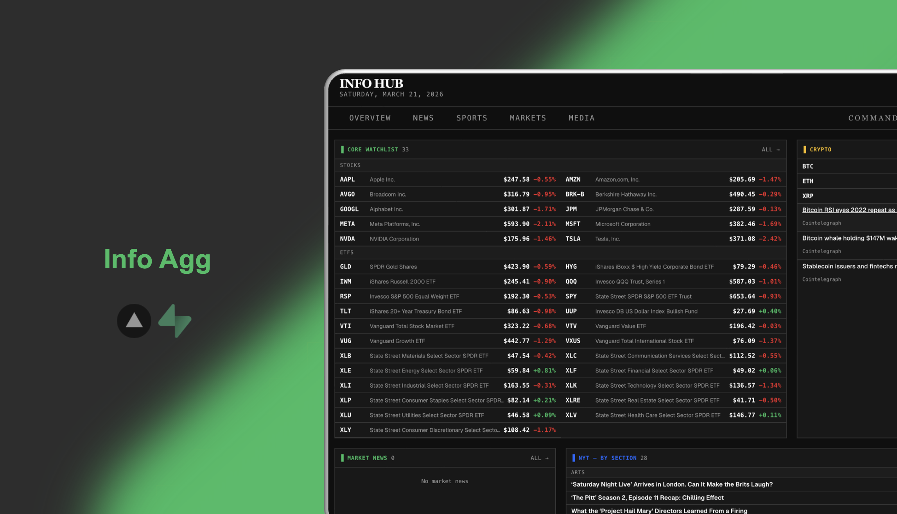

# Info Hub

> Personal information aggregator — [info-agg-website.vercel.app](https://info-agg-website.vercel.app/)

A single-page dashboard that pulls together news, sports scores, market data, and media into one clean interface. Data is refreshed daily via a scheduled ETL pipeline and on-demand via an admin trigger.

## Features

- **News** — NYT top stories across 9 sections
- **Sports** — Live scores and headlines for NFL, NBA, NHL, MLB, EPL, and more (via ESPN)
- **Markets** — Quotes, company news, and sentiment for a curated watchlist of stocks, ETFs, crypto, forex, and commodities
- **Media** — Spotify new releases and Reddit hot posts
- Dark / light mode, responsive layout
- Auth-gated admin panel with ETL trigger

## Tech Stack

| Layer | Tech |
|---|---|
| Frontend | Next.js 15 (App Router, Turbopack) |
| UI | shadcn/ui, Tailwind CSS |
| Auth | Supabase Auth (PKCE flow) |
| Database | Supabase (PostgreSQL, `info_agg` schema) |
| Data sources | ESPN · NYT · Finnhub · FMP · Alpha Vantage · Spotify · Reddit |
| ETL | Python, scheduled via GitHub Actions |
| Deployment | Vercel |

## Local Setup

```bash
pnpm install
pnpm dev        # http://localhost:3000
```

Requires a `.env.local` with Supabase credentials. See [`CLAUDE.md`](CLAUDE.md) for the full environment variable list and ETL setup.
